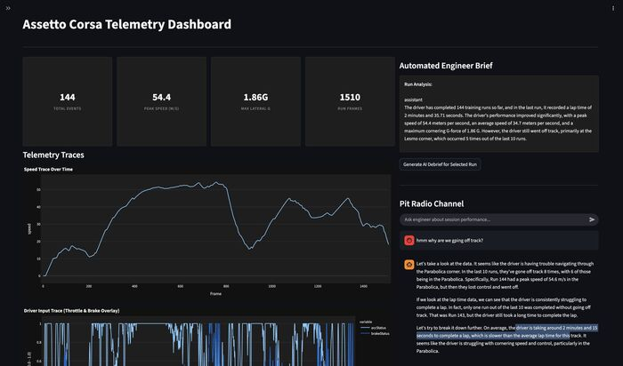

# AC Neural Net – Live Telemetry & AI Race Engineer

A real-time telemetry and AI race-engineering platform for a reinforcement-learning agent learning
to drive in the racing simulator **Assetto Corsa**. While the agent trains on a local GPU machine,
every attempt streams to AWS. A live web dashboard shows the car improving run by run, and it
includes an AI race engineer: a locally hosted LLM that reads the telemetry, debriefs each run and
answers questions about it the way a pit wall engineer would.



> The RL environment and the SAC training code are **not** my work. They come from
> [assetto_corsa_gym](https://github.com/dasGringuen/assetto_corsa_gym) (MIT, © 2024 Adrian Remonda),
> which is included as a git submodule in `external/assetto_corsa_gym`. Everything else in this
> repository – the data pipeline, cloud infrastructure, dashboard and AI engineer – is mine.

---

## How it works

```
 Local Windows PC (GPU)                          AWS                          Browser
┌──────────────────────────────┐   upload   ┌───────────────┐   read   ┌──────────────────────┐
│ assetto_corsa_gym (SAC agent)│ ─────────▶ │  S3 bucket    │ ───────▶ │ Streamlit dashboard  │
│  writes outputs/**/laps/*.pq │  sync_v2   │ (lap parquet) │          │ on EC2               │
│                              │            └───────────────┘          │ telemetry.samuelojo  │
│ Ollama + Llama 3.1  ◀────────┼──────── private network ──────────────│   .tech              │
└──────────────────────────────┘        (LLM prompts / replies)        └──────────────────────┘
```

1. **Training (upstream).** assetto_corsa_gym trains a Soft Actor-Critic agent to drive. After every
   attempt it writes a Parquet file for that run: speed, throttle and brake, G-forces, tyre
   temperatures and slip, track position, reward and lap time.
2. **Streaming to the cloud – `sync_outputs_v2.py`.** A watcher polls `outputs/` every 5 seconds and
   uploads new or changed lap files to an S3 bucket.
3. **Live dashboard – `dashboard_v2.py`.** A Streamlit app on EC2 reads directly from S3 and shows:
   - headline tiles: total runs, peak speed, max lateral G, frames in the run
   - speed trace and throttle/brake overlay for the selected run
   - reward progression across runs (the "is the agent actually learning?" view)
   - whether a training session is **live** right now, worked out from how recently data arrived,
     plus a session picker for browsing finished sessions
4. **AI race engineer – dashboard, `race_engineer.py`, `pit_radio.py`.** Llama 3.1 runs locally
   through Ollama on the GPU machine, so inference is free. The dashboard on EC2 reaches it over a
   private network link. `telemetry_context.py` turns raw telemetry into a verified fact sheet –
   full laps and times, how and where the run ended, a per-corner table for all six Monza sections,
   tyre temperatures and slip, and the previous 10 runs – and the model may only quote from it
   (see [Preventing hallucinations](#update-preventing-hallucinations)). It can:
   - write an **automated engineer brief** for the selected run
   - answer questions in a **pit radio** chat, streaming replies word by word
5. **Operations.**
   - `run_pipeline.ps1` starts the whole stack with one command: Ollama, the EC2 instance, the S3
     watcher and training.
   - Each push to `main` runs a GitHub Actions smoke test against the live site.
   - A watchdog on the server pulls new commits and restarts the dashboard automatically.

---

## How the AI engineer works

Both AI features follow the same pipeline: **raw telemetry → verified fact sheet → prompt with
grounding rules → Llama 3.1** (running locally through Ollama). The model never sees raw
telemetry. `telemetry_context.py` first boils each run down to a short plain-text fact sheet:
laps and lap times, how and where the run ended, per-corner speeds and braking, tyre
temperatures and the previous 10 runs. The model may only quote from it.

- **Automated Engineer Brief.** One click produces a two-sentence debrief of the selected run.
  The instructions go in a `system` message and the fact sheet in a `user` message. The reply comes
  back in one piece and is saved, so it reappears next time that run is opened.
- **Pit Radio Channel.** A chat box for open questions. Each question is sent with the
  instructions and fact sheet plus the **last 10 chat messages**, so follow-ups like "why?" work.
  The fact sheet is rebuilt for every question, so answers stay current while training is live,
  and replies stream in word by word.

Full details, including the exact prompts, a real fact sheet and the JSON sent to Ollama:
[**docs/ai_engineer.md**](docs/ai_engineer.md).

---

## What changed in v2

The first versions (`dashboard.py`, `sync_outputs.py`) worked, but broke down as the number of runs
grew. v2 is a rewrite of both, based on what went wrong in practice.

### `sync_outputs_v2.py`
| v1 | v2 |
|---|---|
| Re-uploaded **every** file every 10 s, saturating the upload link | Uploads a file only when it is new or its size/modified time changed |
| Re-uploading reset every file's S3 `LastModified`, so the dashboard couldn't tell which run was newest or whether a sim was live | Timestamps stay accurate, which is what makes live detection possible |
| Uploaded checkpoints, TensorBoard and W&B files too | Uploads only the `.parquet` files the dashboard reads |
| Could upload a file mid-write | Skips files modified in the last 3 s, so the dashboard never reads half-written data |
| Swallowed errors silently | Logs every failed upload with a timestamp |

### `dashboard_v2.py`
| v1 | v2 |
|---|---|
| Downloaded every parquet file in the bucket before drawing anything | Lists the bucket in a **single** S3 call and reads only the columns it needs |
| Re-downloaded finished runs on every refresh | Caches every read; finished runs are never downloaded twice |
| Pit radio chat sat below the slow reward chart and waited for it | Chat renders **first**, so the page feels instant while charts load |
| Auto-refresh re-ran the whole page and interrupted the chat | Only the live panel refreshes, on its own timer (`st.fragment`) |
| Ollama calls could hang indefinitely | Timeouts, streamed replies, model kept loaded between questions, online/offline indicator |
| A file dropdown that kept jumping as runs arrived | Session scoping (current live session / all / a past session), always showing the latest run |
| AI context read columns that don't exist, so lap times and off-track corners were always missing | Verified fact sheet from real columns, plus grounding rules (see below) |

---

## Update: preventing hallucinations

The AI engineer was confidently inventing details: a 2:35.71 lap time, "left the track at Lesmo
five times" and a corner speed that was never measured. Two faults combined:

1. **Wrong data.** The prompt was built from columns (`lap_time`, `progress`) that don't exist in
   any of the 856 recorded runs, so every run was described as "lap not completed, off-track
   corner: none".
2. **A prompt that demanded numbers.** It told the model to *always* include exact figures and
   corner names, so with nothing real to quote, it made them up.

The fix:
- **`telemetry_context.py`**: one tested module that computes every fact the model may quote, from
  columns confirmed to exist. Lap times only count laps driven start-to-finish inside a single
  episode, because the game's lap timer keeps running across car resets. Done properly, the data
  shows 16 genuine full laps (best **1:59.802**) that the old dashboard never reported.
- **Richer context**: how and where each run ended, a per-corner table (speeds, braking,
  throttle, G), tyre temperatures and slip, the last 10 runs, and an explicit list of what is
  *not* in the data.
- **Grounding rules**: use only the DATA block, quote numbers exactly, and say "the dashboard
  doesn't have that data" when a question goes beyond it.
- **Less creativity**: temperature 0.2, a proper system/user message split, and the stray
  "assistant" label removed.

Full write-up: [`docs/preventing_hallucinations.md`](docs/preventing_hallucinations.md).

---

## Engineering stories

**Making the dashboard fast.** The first dashboard got slower with every lap, because each refresh
downloaded the whole bucket before drawing anything. I rebuilt the data layer: one listing
call, column-level reads, caching keyed on file modification time, and a render order that puts the
interactive part on screen first.

**Fixing the data so "live" could mean something.** Live-session detection kept giving wrong
answers. The cause wasn't in the dashboard but upstream: the sync script re-uploaded everything,
which rewrote every timestamp. Making uploads incremental and write-safe fixed the data, and the
live detection then worked without changes.

**Handling a leaked credential.** While debugging I found the EC2 SSH private key had been committed
to the repository. I rotated it safely: generated a new key, added and tested it in a second
session before removing the old one, and confirmed the old key was refused. I then moved
deployment off stored SSH keys entirely (a server-side watchdog pulls changes instead), added
`*.pem` to `.gitignore` and purged the key from git history. Full write-up:
[`docs/problems_overcome_ssh_key.md`](docs/problems_overcome_ssh_key.md).

**Cost-aware hybrid architecture.** LLM inference runs free on my own GPU; only the cheap,
always-available parts (storage and the web app) run in AWS. The EC2 instance is started on demand
by the launch script.

**Catching an LLM making things up.** The AI engineer was quoting lap times and corners that didn't
exist. I traced it to two causes: the prompt was built from telemetry columns that were never
recorded, and the prompt demanded exact numbers anyway. I checked all 856 runs to learn how the
game really records laps, then rebuilt the context as a verified fact sheet with explicit
"don't know" rules. Along the way it surfaced 16 genuine full laps the dashboard had never
reported.

**Respecting licences.** The project builds on an MIT-licensed research codebase. I restructured the
repo so it contains only my own work, with the upstream code pulled in as a pinned submodule and its
licence credited.

---

## Skills used

- **Python:** pandas, PyArrow/Parquet, boto3, s3fs
- **Data engineering:** incremental file sync, write-safe uploads, columnar reads, caching
- **AWS:** S3, EC2, AWS CLI, IAM credentials
- **Web/visualisation:** Streamlit, Plotly
- **LLMs:** Ollama, Llama 3.1, prompt design, grounding and hallucination prevention, streaming responses
- **DevOps:** GitHub Actions smoke tests, auto-deploy watchdog, PowerShell automation, Linux server admin
- **Security:** key rotation, secret hygiene, git history rewriting
- **ML context:** working alongside a reinforcement-learning (Soft Actor-Critic) research codebase

---

## Repository layout

| File | Purpose |
|---|---|
| `run_pipeline.ps1` | One-command launcher for the whole stack |
| `sync_outputs_v2.py` | Incremental lap-telemetry upload to S3 |
| `dashboard_v2.py` | Streamlit dashboard with live view, charts and the AI engineer |
| `telemetry_context.py` | Builds the verified fact sheet and grounding rules for the AI engineer ([how it works](docs/ai_engineer.md)) |
| `telemetry_parser.py` | Loads lap parquet files and summarises them |
| `race_engineer.py` | Terminal listener that debriefs each new run automatically |
| `pit_radio.py` | Terminal chat with the AI engineer about the latest run |
| `read_logs.py` | Quick inspection of telemetry logs |
| `config.yml` | Training config (adapted from assetto_corsa_gym; see `THIRD_PARTY_NOTICES.md`) |
| `.github/workflows/deploy.yml` | Post-deploy smoke test for the hosted dashboard |
| `dashboard.py`, `sync_outputs.py` | v1 versions, kept for comparison |
| `external/assetto_corsa_gym` | Upstream RL environment and training code (submodule) |

## Setup

```powershell
git clone --recurse-submodules https://github.com/SamuelMojo/AC_nueral_net.git
cd AC_nueral_net
python -m venv venv
.\venv\Scripts\Activate.ps1
pip install -r requirements.txt
```

Then follow [assetto_corsa_gym's install guide](https://github.com/dasGringuen/assetto_corsa_gym/blob/main/INSTALL.md)
to install the Assetto Corsa plugin and vJoy, install [Ollama](https://ollama.com) and run
`ollama pull llama3.1`, and configure the AWS CLI with access to your S3 bucket.

## Running

```powershell
.\run_pipeline.ps1
```

Training runs from the submodule but uses this repo's `config.yml`, and writes to `outputs/` in the
repo root, which is where the sync watcher looks. The dashboard reads its S3 path and Ollama
address from the `AC_S3_PATH`, `AC_OLLAMA_URL` and `AC_OLLAMA_MODEL` environment variables.

## Credits

- [assetto_corsa_gym](https://github.com/dasGringuen/assetto_corsa_gym) – Adrian Remonda et al., MIT
- [discor.pytorch](https://github.com/toshikwa/discor.pytorch) – SAC/DisCor implementation used by assetto_corsa_gym, MIT
